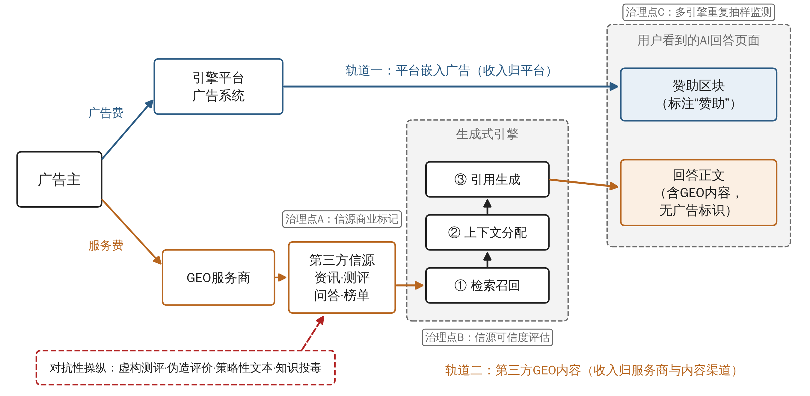

# 生成式引擎优化(GEO)的广告化：运作机制、风险识别与治理路径

【作者姓名】

【作者单位，城市　邮编】

**摘要：**生成式引擎以整合式回答取代链接列表，品牌争夺的对象随之由用户点击转向模型的检索与引用，生成式引擎优化(Generative Engine Optimization, GEO)也由一项内容可见性技术演变为新的广告投放手段。本文以计算机科学、广告学与法学文献为基础，结合平台公告、监管文本和国内典型事件，分析GEO广告化的运作机制、风险与治理。研究发现：GEO作用于检索进入、上下文分配与引用生成三个环节，效果取决于信源权威性和检索相关性，而非创意表现；AI搜索中的商业信息已形成平台标注型嵌入广告与第三方未标注优化内容并存的双轨结构，后者不在《互联网广告管理办法》列举的标识情形之内；策略性文本、偏好操纵与检索投毒使GEO与信息污染之间缺少技术边界，2026年“3·15”晚会曝光的“AI投毒”是其现实形态；零点击化使按点击计价与归因的效果体系失效，GEO服务的效果难以审计。据此，本文提出以商业目的和对价关系认定GEO内容的广告属性，在信源端设置可随检索传递的商业标记，以重复抽样测量取代单次截图验收，并分别对广告主、生成式引擎平台、GEO服务商与监管部门提出管理建议。

**关键词：**生成式引擎优化；AI搜索广告；广告可识别性；说服知识模型；平台治理

**中图分类号：**F713.8

## The Advertising Turn of Generative Engine Optimization (GEO): Mechanisms, Risks and Governance

[Author Name]

[Affiliation, City Postcode]

**Abstract:** Generative engines replace ranked links with synthesized answers, shifting brand competition from user clicks to model retrieval and citation. Generative Engine Optimization (GEO) has consequently evolved from a content-visibility technique into a new means of advertising. Drawing on literature from computer science, advertising and law, together with platform announcements, regulatory texts and recent cases in China, this paper analyzes the mechanisms, risks and governance of GEO as advertising. GEO operates at three stages, namely retrieval entry, context allocation and citation generation, and its effect depends on source authority and retrieval relevance rather than creative execution. Commercial information in AI search now follows a dual track: platform-labeled ads placed in separate sponsored units, and unlabeled third-party optimized content inside the answers themselves. The latter falls outside the labeling situations enumerated in China's Measures for the Administration of Internet Advertising. Strategic text sequences, preference manipulation and retrieval poisoning leave no technical boundary between GEO and information pollution, as the "AI poisoning" exposed at the 2026 "3·15" gala shows. Zero-click search also undermines click-based pricing and attribution, leaving GEO services difficult to audit. The paper proposes recognizing the advertising nature of GEO content by commercial purpose and consideration, attaching source-level commercial markers that travel through retrieval, and replacing one-off screenshots with repeated-sampling measurement. It also offers recommendations for advertisers, generative engine platforms, GEO service providers and regulators.

**Key words:** Generative Engine Optimization; AI Search Advertising; Advertising Identifiability; Persuasion Knowledge Model; Platform Governance

## 1 引言

截至2025年12月，我国生成式人工智能用户规模达6.02亿人，普及率为42.8%[1]。用户获取信息的入口正在从搜索结果页转向AI给出的整合式回答。皮尤研究中心基于900名美国成年人2025年3月浏览记录的分析显示，当谷歌搜索结果页出现AI摘要时，用户点击传统搜索结果的访问占比为8%，未出现摘要时为15%；点击摘要内所引来源的访问只占1%[2]。Gartner在2024年预测，到2026年传统搜索引擎的使用量将因AI聊天机器人和虚拟代理而下降25%[3]。谷歌则称其自然点击总量同比“相对稳定”，但没有公布具体数据[4]。双方的分歧在于总量；在单次查询层面，AI回答减少了用户向外部网页的跳转，这一点已有行为数据支持。

广告投放随之进入回答本身。谷歌于2024年10月在美国移动端的AI概览(AI Overviews)中上线广告，现有的搜索、购物和效果最大化广告系列自动获得展示资格[5]；Perplexity于2024年11月以标注“赞助”的追问问题测试广告，按千次展示计价[6]；OpenAI于2026年1月宣布在ChatGPT免费版和Go版中测试广告[7]，同年8月称该业务上线不足200天即达到10亿美元的年化收入运行率[8]。国内方面，百度2025年第三季度在线营销收入为153亿元，同比减少18%，同期AI原生营销服务收入为28亿元，同比增长262%[9]。广告预算正在由链接列表旁的关键词广告位流向AI生成的回答。

平台广告体系之外，品牌还可以通过改写和投放内容，让自身信息出现在AI的“自然”回答中。Aggarwal等将这类做法命名为生成式引擎优化(Generative Engine Optimization, GEO)，并在其构建的基准上报告了最高约40%的可见度提升[10]。这项技术在国内很快被商品化。新华社2026年1月的调查发现，部分广告代理机构以语义优化、结构化标记和提升信源权威性等方式，把客户信息植入AI搜索结果[11]；同年央视“3·15”晚会曝光，记者用购得的GEO软件为一款虚构的智能手环批量生成文章，发布后被多个大模型抓取并写入推荐性回答[12]。出资购买AI回答中的位置，以推销商品为目的，GEO在功能上已经是广告，却没有任何广告标识。

现有研究从三个方向触及这一现象。计算机科学研究把GEO看作内容优化或对抗攻击问题，关注可见度的提升幅度与模型的鲁棒性[10,13,14]；经济学与机制设计研究讨论如何在大语言模型输出中拍卖广告位[15,16]；管理学研究开始梳理AI对在线广告生态的冲击，唐欣琳将GEO列为出版商应对流量下滑的策略之一，并指出广告逻辑正从争夺用户注意力转向影响AI对用户偏好的判断[17]。信息检索领域已有研究讨论生成式回答中的原生广告[18]，但其对象是由系统自行植入的广告，而非第三方通过影响信源进入回答的内容。这些研究都没有把GEO本身作为一种广告行为来分析：它如何进入AI回答，与平台付费广告是什么关系，给广告可识别性和市场秩序带来哪些问题，又应当由谁承担什么义务。

本文围绕上述问题展开。第2节说明研究方法；第3节界定GEO并提出理论基础；第4节分析GEO广告化的运作机制；第5节识别其风险；第6节提出治理路径与管理启示；第7节总结全文。

## 2 研究方法

本文采用文献研究、政策文本分析与典型事件分析相结合的方法，所用材料分为三类。

第一类为学术文献。检索入口包括学术搜索引擎，以及ACM Digital Library、ACL Anthology、NeurIPS、ICLR与USENIX Security会议论文集、arXiv、INFORMS期刊平台和国内法学期刊官网。英文检索词为generative engine optimization、generative search engine、LLM advertising、ad auction、native advertising disclosure、persuasion knowledge等，中文检索词为生成式引擎优化、AI搜索、原生广告、植入式广告、可识别性等。生成式引擎相关文献的时间范围为2023年至2026年，搜索广告和广告披露领域另纳入1994年至2016年的奠基性研究。纳入标准为：①研究对象是生成式引擎或对话式搜索中的内容可见性、广告投放或排序操纵；②或为搜索广告、原生广告披露领域的基础研究；③能够在出版方页面或预印本平台核实作者、出处与主要结论。缺少方法说明的营销白皮书和服务商推广文章不予纳入。检索中发现，各机构对国内GEO市场规模的估计口径不一，数值相差一个数量级以上，且多数无法回溯原始报告，本文因此不使用此类数据。最终纳入学术文献26篇。

第二类为政策文本，包括《中华人民共和国广告法》《互联网广告管理暂行办法》《互联网广告管理办法》《互联网广告可识别性执法指南》《互联网信息服务算法推荐管理规定》《生成式人工智能服务管理暂行办法》《人工智能生成合成内容标识办法》和2025年修订的《中华人民共和国反不正当竞争法》，共8部。

第三类为统计报告、平台公告与典型事件，包括中国互联网络信息中心和皮尤研究中心的统计数据，谷歌、Perplexity、OpenAI的官方公告，百度财报的媒体报道，以及新华社调查和“3·15”晚会的相关报道。文中所有数据均标注来源与时点。

## 3 概念界定与理论基础

### 3.1 生成式引擎与生成式引擎优化

生成式引擎是把信息检索与大语言模型生成能力结合起来的系统。它在收到查询后检索相关网页，把检索结果放入模型上下文，由模型生成带有来源标注的自然语言回答。其技术基础是检索增强生成(Retrieval-Augmented Generation, RAG)，即以外部文档库作为非参数记忆，补充模型参数中的知识[19]。从内容方的角度看，一条信息要进入最终回答，需要依次通过三道关口：被检索系统召回，在有限的上下文中获得位置，在生成时被模型采纳和引用。

引用标注并不保证回答可以核验。Liu等对Bing Chat、NeevaAI、perplexity.ai和YouChat的人工评估显示，平均只有51.5%的生成语句得到引用的完整支持，只有74.5%的引用支持其所附语句；引用精确率与用户感知的有用性呈强负相关(r=-0.96)[20]。看起来越有用的回答，引用越不可靠，用户很难凭引用标注判断回答内容是否有可信出处。

Aggarwal等首次将面向生成式引擎的内容优化定义为GEO，把它表述为内容创作者在黑箱条件下提升自身内容在生成式回答中可见度的优化问题，并以位置加权的词数和主观印象等指标度量可见度[10]。他们在GEO-bench上发现，加入引用、相关引语和统计数据等改写方式能够显著提升可见度，最高约40%，效果随领域而变化。后续研究拓展了GEO的方法与证据。Chen等的对照实验显示，主流AI搜索系统对第三方“赢得媒体”(earned media)存在系统性偏好，品牌自有内容和社交媒体内容较少被采用，不同引擎在域名多样性、时效性和措辞敏感性上差异显著[21]。Wu等让模型从可见度不同的文档对中归纳生成式引擎的偏好规则，据此改写内容，在提升内容被采用程度的同时没有降低引擎的回答质量[22]。Martinez对2023年至2026年的45项研究进行了批判性综述，认为GEO是覆盖检索激活、抓取索引、检索、重排与上下文分配、引用和用户行为的多阶段过程；其中话题相关性和上下文位置是最可靠的因素，通用改写技巧的迁移性较差，多方同时优化时个体增益会被侵蚀，商业审计中不同次运行之间的引用来源重叠度低[23]。

### 3.2 GEO与搜索引擎优化、付费搜索广告的比较

在搜索广告时代，品牌进入搜索结果页有两条路径。一是付费搜索广告，平台通过广义二价拍卖出售关键词对应的广告位[24]，广告效果可以按排名、点击率和转化率追踪。Ghose和Yang的实证研究发现，转化率随排名下降而降低，但最靠前的位置并不总是对广告主最有利[25]。二是搜索引擎优化(SEO)，即通过改进网页争取自然排名。Berman和Katona证明，在没有赞助链接的情形下，只有当网站质量与其对消费者的价值足够正相关时，SEO才会改善自然排名[26]。两条路径在我国受到不同的规则约束：2016年《互联网广告管理暂行办法》要求付费搜索广告与自然搜索结果明显区分[27]，2023年《互联网广告管理办法》延续这一要求，规定竞价排名的商品或服务应显著标明“广告”[28]，自然排名则不属于广告。

GEO兼有两条路径的特征。与SEO相同，它不向引擎平台付费，争取的是“自然”位置；与付费广告相同，它由品牌出资委托服务商实施，目的在于推销特定商品或服务，而且其产物直接以引擎的口吻呈现给用户。表1对三者进行了比较。

**表1　付费搜索广告、SEO与GEO的比较**

| 维度 | 付费搜索广告 | 搜索引擎优化(SEO) | 生成式引擎优化(GEO) |
|---|---|---|---|---|
| 作用对象 | 关键词拍卖中的广告位 | 搜索引擎的排序算法 | 生成式引擎的检索、上下文分配与引用 |
| 呈现位置 | 结果页中独立的广告位 | 自然结果列表中的链接 | 回答正文中的表述或所引来源 |
| 资金流向 | 支付给搜索引擎平台 | 支付给优化服务商或内部团队 | 支付给GEO服务商和第三方内容渠道 |
| 用户可识别性 | 须显著标明“广告” | 用户知道是排序结果，可点击核验 | 无标识，与引擎的回答混为一体 |
| 效果度量 | 展示、点击、转化可追踪 | 排名与流量可追踪 | 被提及率和提及位置，点击极少，结果随机波动 |
| 现行规则定位 | 互联网广告 | 一般不视为广告 | 尚无明确定位 |

### 3.3 理论基础：说服知识与“对代理人的说服”

说服知识模型认为，消费者在长期接触营销信息的过程中积累了关于说服企图的知识，一旦识别出某条信息是说服企图，就会调用这些知识加以应对，例如提高警惕、降低对信息的信任[29]。广告标识的作用就在于触发这一识别过程。Boerman等的实验显示，6秒时长的赞助披露能够激活消费者的概念性和态度性说服知识，并经由后者降低品牌态度[30]；Wojdynski和Evans对网络原生广告的实验发现，能够识别出赞助文章是广告的读者比例很低，披露的位置和措辞显著影响识别率[31]。

生成式回答进一步削弱了这一识别过程。Zelch等让大语言模型在生成结果中植入品牌信息后开展用户调查，发现相当一部分参与者没有注意到这些非预期的品牌和产品植入[18]。原因在于，回答以中立助手的身份给出，用户把筛选信息的工作委托给了引擎，被说服的对象首先是引擎，其次才是用户。GEO利用的正是这种委托关系：品牌不再直接说服消费者，而是通过影响引擎所依据的材料，让引擎替自己说话。消费者没有识别出说服企图，说服知识就不会被激活，广告信息以“答案”的形式被接受。唐欣琳所说的广告逻辑由争夺注意力转向影响AI对用户偏好的判断[17]，在GEO上表现为说服对象从人转向了作为代理人的模型。这一机制既解释了GEO对广告主的吸引力，也说明了它为什么构成消费者保护问题。

## 4 GEO广告化的运作机制

### 4.1 作用环节：从购买广告位到经营信源

按照3.1节所述的三道关口，GEO的商业实践可以分为三类操作。

在检索进入环节，内容必须先被引擎召回。AI搜索偏好第三方赢得媒体[21]，品牌自有网站即使经过改写，也未必能进入候选集，GEO的重心因此转到第三方信源上，即在资讯站点、测评文章、问答社区和行业榜单中铺设内容。新华社调查所描述的“提升信源权威性”[11]，以及“3·15”晚会后被披露的批量生成虚假评测、伪造用户评价、杜撰行业排名并经自媒体账号发布[32]，都发生在这一环节。搜索广告时代的媒介购买对象是平台广告位，GEO时代的购买对象变成了引擎所信任的信源。

在上下文分配环节，被召回的内容还要在有限的上下文中占据有利位置。Pfrommer等发现，不同大语言模型对产品名称、文档内容和上下文位置的依赖程度差异很大，针对性构造的注入文本能够提升低排名产品在对话式搜索引用中的次序，且这一效果可迁移到perplexity.ai等实际系统[33]。Martinez的综述也将上下文位置列为最可靠的影响因素之一[23]。

在引用生成环节，内容的表述方式决定它能否被模型采纳。Aggarwal等发现统计数据、引语和引用来源能提升可见度[10]。Kumar和Lakkaraju进一步表明，在产品信息页中加入经过优化的策略性文本序列，可以显著提高该产品成为大语言模型首要推荐的概率[13]。

三个环节合在一起，GEO的效果主要来自信源的权威性、内容与查询的相关性以及文本对模型的适配程度，与传统广告所依赖的创意表现和情感诉求关系不大。唐欣琳观察到AI代理更偏好结构化数据而非视觉创意[17]，GEO的实践印证了这一判断。

### 4.2 双轨结构：平台嵌入广告与第三方优化内容

AI搜索中的商业信息目前沿两条轨道进入用户视野(图1、表2)。

**图1　生成式引擎中商业信息的两条进入路径**

第一条轨道是平台嵌入广告。谷歌、Perplexity和OpenAI都以标注“赞助”的独立区块展示广告，与生成的回答正文相区分[5-7]；OpenAI和Perplexity还明确声明广告主不能影响回答内容[6,7]。机制设计研究为这条轨道提供了定价与分配方案：Dütting等设计了让多个以大语言模型表达偏好的广告主逐词元竞价的拍卖机制[15]；Dubey等将位置拍卖推广到广告主竞争进入同一段LLM摘要的情形[34]；Hajiaghayi等提出基于检索增强生成的分段拍卖，按出价和相关性为每个输出片段分配广告[16]；Feizi等指出，搜索广告框架不能直接迁移到LLM广告，隐私、时延和可靠性都需要重新考虑[35]。Hu等构建的基准显示，直接让模型在回答中植入广告虽能获得一定点击，却会降低用户满意度[36]，这与平台把广告和回答分开展示的做法相一致。

第二条轨道是第三方GEO内容。它不经过平台的广告系统，不向平台付费，以回答正文的形式出现，没有任何标识，收入归属GEO服务商和内容渠道。按内容是否真实，这条轨道又分为基于真实信息的合规优化和虚构内容的对抗性操纵。

两条轨道之间存在张力。平台嵌入广告的商业价值以“回答独立于广告”为前提，OpenAI和Perplexity都就此作出了公开承诺；第三方GEO的价值恰恰来自影响回答。前者越依赖回答的公信力，后者越有动力利用这份公信力。前述Berman和Katona关于SEO的结论在此可以移用：提供可核验信息的GEO接近“质量与消费者价值正相关”的条件，能够改善回答质量；伪造测评和排名的GEO与之相反[26]。

**表2　AI搜索中商业信息的进入路径**

| 维度 | 平台嵌入广告 | 合规GEO | 对抗性操纵 |
|---|---|---|---|---|
| 实施主体 | 引擎平台与广告主 | 广告主委托GEO服务商 | GEO服务商或其他第三方 |
| 作用位置 | 回答区域内或周边的独立标注区块 | 回答正文与引用来源 | 回答正文与引用来源 |
| 内容真实性 | 受平台广告审核约束 | 基于真实信息的改写与分发 | 虚构测评、评价、排名或嵌入策略性文本 |
| 用户可识别性 | 标注“赞助” | 无标识 | 无标识 |
| 收入归属 | 引擎平台 | 服务商与内容渠道 | 服务商与内容渠道 |
| 典型例子 | 谷歌AI概览广告、Perplexity赞助追问、ChatGPT广告 | 补充产品参数、争取第三方报道 | “3·15”晚会曝光的虚构手环推荐 |

## 5 GEO广告化的风险

### 5.1 广告可识别性被消解

《广告法》第十四条要求广告具有可识别性，能够使消费者辨明其为广告[37]。《互联网广告管理办法》第九条将这一要求具体化为两类情形：竞价排名的商品或服务须显著标明“广告”，并与自然搜索结果明显区分；以知识介绍、体验分享、消费测评等形式推销商品或服务并附加购物链接等购买方式的，须显著标明“广告”[28]。GEO内容落在这两类情形之外。它不是竞价排名，因为品牌没有向引擎平台付费；进入AI回答后，它通常也不附带购物链接。《互联网广告可识别性执法指南》指出，是否标明“广告”不是判断某一内容是否构成广告的依据[38]，这为把GEO内容认定为广告留出了空间，但标识义务由谁在哪个环节履行，现有规则没有回答。

李剑在研究植入式广告时指出，植入式广告本质上仍是广告，其隐蔽性与可识别性要求相冲突，应按危害程度分类规制并健全披露制度[39]。GEO可以看作植入式广告在生成式引擎中的延伸，区别在于执行“植入”的是模型：广告主和服务商影响的是模型的输入材料，最终决定写入哪些内容、如何表述的是模型。这使广告发布者的认定变得困难。引擎平台没有收取广告费，也不知道哪些信源是付费内容，难以被认定为广告发布者；GEO服务商控制的是第三方信源，而不是回答本身。

现有的AI内容标识规则也填补不了这一空白。《生成式人工智能服务管理暂行办法》和《人工智能生成合成内容标识办法》要求服务提供者对生成合成内容添加显式和隐式标识[40,41]，标明的是“由AI生成”，而不是“含有商业推广”。一段混入GEO内容的AI回答可以完全符合AI标识要求，同时没有任何广告标识。

技术检测同样存在难点。Schmidt等构建了在对话式搜索回答中插入广告的数据集，发现所测试的大语言模型难以识别这些广告，经过训练的句向量模型的精确率和召回率则均超过0.9；他们还发现，自然回答在复用品牌官网文本时同样会出现广告化表述[42]。检测“回答中有没有推销性语言”在技术上可行，但要区分这类语言来自付费GEO还是来自引擎对品牌官网的正常引用，单靠文本本身做不到。

### 5.2 信息污染与对抗性操纵

GEO与操纵处在同一条连续谱上。一端是补充统计数据和引语的内容改写[10]，向另一端依次是针对模型优化的策略性文本[13]、诱导模型偏向特定产品的偏好操纵[14]和改变引用排序的提示注入[33]，最远端是向检索库注入虚假文本的知识投毒。Zou等的实验显示，在包含数百万条文本的知识库中，为每个目标问题注入5条恶意文本即可达到90%的攻击成功率，现有防御手段不足以应对[43]。这些手段依据的是同一个原理：改变模型读到的材料。服务商从合规改写滑向操纵，不需要改变技术路线，只需要放弃内容的真实性。

国内已经出现了处在连续谱远端的案例。“3·15”晚会中，一款虚构的智能手环经GEO软件批量生成的文章投放后，被多个大模型抓取引用并给出推荐[12]，伪造“市场共识”的成本之低由此可见。由于引用标注本身并不可靠[20]，用户很难从回答中察觉问题。Nestaas等在Bing和Perplexity等实际系统上验证了偏好操纵攻击，并指出这一局面构成囚徒困境：每个参与方都有动机发起攻击，所有人都攻击时，模型的输出质量整体下降；在他们的实验中，注入页面增多后，包括攻击者在内的各产品推荐率普遍下降[14]。

现行法律对这类行为有部分约束。2025年修订的《反不正当竞争法》第九条将虚假宣传的误导对象扩展到其他经营者，并新增“虚假评价”行为类型[44]，伪造测评、评价和排名可以据此追究。《互联网信息服务算法推荐管理规定》第十四条禁止算法推荐服务提供者利用算法操纵榜单或检索结果排序等干预信息呈现[45]，但该条约束的是服务提供者自身，GEO操纵者是影响引擎输入的第三方，不在其直接适用范围内。已有研究从信息内容治理的角度讨论了大模型输出的治理责任[46]，GEO操纵把这一问题延伸到了模型的输入端。

### 5.3 竞争结构失衡

AI搜索对第三方赢得媒体的偏好以及由此产生的大品牌偏向[21]，使GEO的回报向已有媒体声量和第三方报道的大品牌集中。中小品牌缺少获得权威报道的渠道，更容易转向成本低廉的批量内容生成，而这正是“3·15”晚会所曝光的做法[12,32]。结果是两种失衡同时出现：在合规路径上大品牌占优，在违规路径上中小商家承担法律风险。Martinez的综述还表明，多方同时优化时个体增益会相互侵蚀[23]。GEO支出因此带有军备竞赛的性质，广告主为维持原有的可见度不得不持续投入，这些投入并不增加用户可获得的信息总量。

### 5.4 效果度量与计价失灵

搜索广告的计价与归因建立在点击之上，AI回答减少了点击。皮尤的数据中，用户点击AI摘要内引用来源的访问只占1%[2]。即便谷歌所称的自然点击总量稳定属实[4]，品牌信息的价值也越来越多地在回答内部实现，不再表现为可追踪的跳转。平台广告方面，Perplexity按千次展示计价[6]，谷歌AI概览广告沿用既有的搜索广告系列[5]，计价单位正由点击回到展示。

GEO的度量问题更为突出。它的效果体现为品牌在回答中被提及的频率和位置，而生成式回答具有随机性。Martinez指出，商业审计中不同次运行之间引用来源的重叠度低、波动大，其综述的研究中没有一种GEO技术在跨平台的自然可发现性上显示出稳定效果[23]。GEO服务以把客户信息植入AI回答为卖点[11]，如果以单次提问的结果作为验收依据，广告主无法区分真实效果与随机波动。广告主购买的是一项难以审计的服务，信息优势在服务商一方，这为夸大效果和以操纵手段“保量”留下了空间。

## 6 治理路径与管理启示

### 6.1 以商业目的和对价关系认定GEO内容的广告属性

可识别性执法指南已经确立了不以是否标注作为广告认定依据的原则[38]。在此基础上，GEO内容的广告属性可以按两个条件认定：内容的制作和分发是否以推销特定商品或服务为目的；广告主是否为此向服务商或内容渠道支付了对价。两项条件同时满足的，应视为互联网广告。这一标准与正常的公关传播可以区分：媒体在未收取对价、保有编辑决定权的情况下独立撰写的报道，不构成广告；向内容渠道付费发布的测评、榜单和资讯，则与以新闻报道形式变相发布的广告性质相同，《广告法》第十四条对后者早有禁止[37]。建议在《互联网广告管理办法》第九条的列举情形中增加“通过制作、分发内容影响生成式人工智能输出以推销商品或者服务”，明确广告主承担首要责任，GEO服务商承担广告经营者责任。

### 6.2 在信源端设置可随检索传递的商业标记

GEO内容进入回答之前，最后一个由人控制的环节是在第三方信源上发布。标识义务应设在这一环节：广告主和服务商在投放的测评、榜单、资讯等内容上显著标注“广告”或“推广”，并在网页元数据中写入机器可读的商业属性标记。《人工智能生成合成内容标识办法》已经建立了显式标识与元数据隐式标识并行的做法[41]，商业标记可以沿用这一结构。生成式引擎在检索时读取该标记，对带有商业标记的信源降低权重，或在引用该信源时向用户提示。这样，标识随内容进入引擎，平台无须事后判断哪些内容是付费的。

### 6.3 生成式引擎平台：维护回答的独立性

回答的独立性是生成式引擎平台广告业务成立的前提[7]。平台应当做好三件事。其一，将付费广告与回答在位置和视觉上分开，并在广告政策中明确禁止广告主借助第三方内容影响回答。其二，建立信源可信度评估和异常内容识别机制，重点识别短时间内批量出现、措辞高度相似的测评和榜单；对生成式回答中广告内容的检测已有可行的技术方案[42]。其三，公开内容质量准则，引导GEO走向与引擎目标一致的方向。Wu等的研究表明，按照引擎偏好规则优化内容，可以在提升内容被采用度的同时不降低回答质量[22]。平台有条件把这类规则转化为面向内容方的公开指南，这与搜索引擎以站长指南规范SEO的做法类似。

### 6.4 广告主与GEO服务商：可核验的内容与可审计的效果

对广告主而言，在AI回答中获得可见度最稳妥的方式，是让引擎能够检索到完整、准确、可核验的产品信息，并通过真实的第三方报道和用户评价积累赢得媒体[21]。与GEO服务商签约时，应在合同中禁止虚构测评、评价和排名，并约定违约责任。2025年修订的《反不正当竞争法》已将虚假评价列为规制对象[44]，广告主是虚假评价的直接受益者，在合同中排除此类做法是控制自身法律风险的必要措施。效果验收应采用重复抽样：在多个引擎、多种问法和不同时间点上重复提问，统计品牌被提及的比例和位置分布，并设置不做优化的对照品类[23]，以此取代单次截图。

对GEO服务商而言，行业组织可以制定服务规范，要求披露内容投放的渠道和数量、标注商业属性，并统一效果报告的测量方法。

### 6.5 监管部门：协调两套标识规则

市场监管部门负责广告标识，网信部门负责AI生成内容标识，两套规则目前各管一段[28,41]。建议两部门在执法上建立协作：市场监管部门以广告可识别性和反不正当竞争规则为依据，查处未标识的GEO广告和虚假评价；网信部门在生成式人工智能服务的备案与安全评估中，加入防范信源投毒和商业内容渗透的要求。执法方式上，可以借鉴GEO效果审计的方法，以多引擎、多问法的抽样监测发现异常推荐，再沿信源追溯投放主体。

## 7 结论

生成式引擎改变了品牌进入用户视野的方式，GEO随之成为一种不经过平台广告系统、以回答正文为载体的广告形态。本文得出四点结论。第一，GEO作用于检索进入、上下文分配和引用生成三个环节，媒介购买的对象由平台广告位转为引擎所信任的第三方信源，效果取决于信源权威性和检索相关性。第二，AI搜索中的商业信息沿平台嵌入广告和第三方GEO两条轨道进入回答，前者有标识、收入归平台，后者无标识、收入归服务商和内容渠道，《互联网广告管理办法》列举的标识情形只覆盖前者。第三，GEO与信息操纵依据同一套技术原理，从合规改写到知识投毒之间没有技术边界，“3·15”晚会曝光的案例已经显示了其现实危害。第四，零点击化和生成结果的随机性使按点击计价与单次截图验收都不再可靠。在治理上，本文主张以商业目的和对价关系认定GEO内容的广告属性，在信源端设置可随检索传递的商业标记，由平台维护回答的独立性，由广告主以重复抽样验收效果，并由市场监管与网信部门协调两套标识规则。

本研究基于公开文献、政策文本和媒体报道，未取得GEO服务商和平台的内部数据；文中引用的多项GEO实验来自研究者自建的基准和预印本，其结论适用于相应的实验设置。后续研究可以在三个方向推进：通过田野实验测量GEO在真实引擎中的效果及其持续时间；通过消费者实验检验AI回答中不同广告标识方式对说服知识激活的影响；跟踪GEO相关执法案例，检验本文提出的认定规则在实践中的可操作性。

## 参考文献

[1] 中国互联网络信息中心. 第57次中国互联网络发展状况统计报告[R/OL]. 北京: 中国互联网络信息中心, 2026. https://www.cnnic.cn/NMediaFile/2026/0304/MAIN1772588317069TUXN3827X8.pdf.  
[2] CHAPEKIS A, LIEB A. Google users are less likely to click on links when an AI summary appears in the results[EB/OL]. (2025-07-22). https://www.pewresearch.org/short-reads/2025/07/22/google-users-are-less-likely-to-click-on-links-when-an-ai-summary-appears-in-the-results/.  
[3] Gartner. Gartner predicts search engine volume will drop 25% by 2026, due to AI chatbots and other virtual agents[EB/OL]. (2024-02-19). https://www.gartner.com/en/newsroom/press-releases/2024-02-19-gartner-predicts-search-engine-volume-will-drop-25-percent-by-2026-due-to-ai-chatbots-and-other-virtual-agents.  
[4] REID L. AI in Search is driving more queries and higher quality clicks[EB/OL]. (2025-08-06). https://blog.google/products/search/ai-search-driving-more-queries-higher-quality-clicks/.  
[5] Google. New ways for marketers to reach customers with AI Overviews and Lens[EB/OL]. (2024-10). https://blog.google/products/ads-commerce/google-lens-ai-overviews-ads-marketers/.  
[6] Search Engine Land. Perplexity begins testing ads as sponsored follow-up questions[EB/OL]. (2024-11). https://searchengineland.com/perplexity-begins-testing-ads-448277.  
[7] SIMO F. Our approach to advertising and expanding access to ChatGPT[EB/OL]. (2026-01-16). https://openai.com/index/our-approach-to-advertising-and-expanding-access/.  
[8] OpenAI. Expanding access to AI with ChatGPT ads[EB/OL]. (2026-08-31). https://openai.com/index/expanding-access-to-ai-with-chatgpt-ads/.  
[9] 澎湃新闻. 百度三季度营收同比下滑7%，AI业务收入同比增超五成[EB/OL]. (2025-11-18). https://m.thepaper.cn/newsDetail_forward_31992080.  
[10] AGGARWAL P, MURAHARI V, RAJPUROHIT T, et al. GEO: generative engine optimization[C]//Proceedings of the 30th ACM SIGKDD Conference on Knowledge Discovery and Data Mining. New York: ACM, 2024: 5-16. DOI: 10.1145/3637528.3671900.  
[11] 新华社. 新华调查｜AI给出的搜索结果，可信吗？[EB/OL]. (2026-01-16). https://www.news.cn/tech/20260116/ad7da1553e80447fb47a7170d7412fde/c.html.  
[12] 新浪财经. 央视3·15晚会曝光AI大模型“投毒”黑产：「力擎GEO优化系统」被点名[EB/OL]. (2026-03-16). https://finance.sina.com.cn/stock/t/2026-03-16/doc-inhrcxwy9819362.shtml.  
[13] KUMAR A, LAKKARAJU H. Manipulating large language models to increase product visibility[EB/OL]. (2024-04-11). https://arxiv.org/abs/2404.07981.  
[14] NESTAAS F, DEBENEDETTI E, TRAMÈR F. Adversarial search engine optimization for large language models[C]//The Thirteenth International Conference on Learning Representations. 2025.  
[15] DÜTTING P, MIRROKNI V, PAES LEME R, et al. Mechanism design for large language models[C]//Proceedings of the ACM Web Conference 2024. New York: ACM, 2024: 144-155.  
[16] HAJIAGHAYI M, LAHAIE S, REZAEI K, et al. Ad auctions for LLMs via retrieval augmented generation[C]//Advances in Neural Information Processing Systems 37. Red Hook: Curran Associates, 2024. DOI: 10.52202/079017-0585.  
[17] 唐欣琳. AI驱动在线广告生态系统演化变革：管理策略的理论探索[J]. 管理科学与工程, 2026, 15(3): 721-731. DOI: 10.12677/mse.2026.153070.  
[18] ZELCH I, HAGEN M, POTTHAST M. A user study on the acceptance of native advertising in generative IR[C]//Proceedings of the 2024 Conference on Human Information Interaction and Retrieval. New York: ACM, 2024: 142-152. DOI: 10.1145/3627508.3638316.  
[19] LEWIS P, PEREZ E, PIKTUS A, et al. Retrieval-augmented generation for knowledge-intensive NLP tasks[C]//Advances in Neural Information Processing Systems 33. Red Hook: Curran Associates, 2020: 9459-9474.  
[20] LIU N F, ZHANG T, LIANG P. Evaluating verifiability in generative search engines[C]//Findings of the Association for Computational Linguistics: EMNLP 2023. Singapore: ACL, 2023: 7001-7025. DOI: 10.18653/v1/2023.findings-emnlp.467.  
[21] CHEN M, WANG X, CHEN K, et al. Generative engine optimization: how to dominate AI search[EB/OL]. (2025-09-10). https://arxiv.org/abs/2509.08919.  
[22] WU Y, ZHONG S, KIM Y, et al. What generative search engines like and how to optimize web content cooperatively[C]//The Fourteenth International Conference on Learning Representations. 2026.  
[23] MARTINEZ O. Optimizing visibility in generative engines: a critical survey of generative engine optimization (2023-2026)[EB/OL]. (2026-07-15). https://arxiv.org/abs/2607.14035.  
[24] EDELMAN B, OSTROVSKY M, SCHWARZ M. Internet advertising and the generalized second-price auction: selling billions of dollars worth of keywords[J]. American Economic Review, 2007, 97(1): 242-259. DOI: 10.1257/aer.97.1.242.  
[25] GHOSE A, YANG S. An empirical analysis of search engine advertising: sponsored search in electronic markets[J]. Management Science, 2009, 55(10): 1605-1622. DOI: 10.1287/mnsc.1090.1054.  
[26] BERMAN R, KATONA Z. The role of search engine optimization in search marketing[J]. Marketing Science, 2013, 32(4): 644-651. DOI: 10.1287/mksc.2013.0783.  
[27] 国家工商行政管理总局. 互联网广告管理暂行办法: 国家工商行政管理总局令第87号[Z]. 2016-07-04.  
[28] 国家市场监督管理总局. 互联网广告管理办法: 国家市场监督管理总局令第72号[Z]. 2023-02-25.  
[29] FRIESTAD M, WRIGHT P. The persuasion knowledge model: how people cope with persuasion attempts[J]. Journal of Consumer Research, 1994, 21(1): 1-31. DOI: 10.1086/209380.  
[30] BOERMAN S C, VAN REIJMERSDAL E A, NEIJENS P C. Sponsorship disclosure: effects of duration on persuasion knowledge and brand responses[J]. Journal of Communication, 2012, 62(6): 1047-1064. DOI: 10.1111/j.1460-2466.2012.01677.x.  
[31] WOJDYNSKI B W, EVANS N J. Going native: effects of disclosure position and language on the recognition and evaluation of online native advertising[J]. Journal of Advertising, 2016, 45(2): 157-168.  
[32] 新华网. 热点追踪｜AI也会被“投毒”，我们该如何避坑？[EB/OL]. (2026-03-24). https://www.news.cn/sikepro/20260324/494ee57bffef4bab90d3ca0e0d9fcb0c/c.html.  
[33] PFROMMER S, BAI Y, GAUTAM T, et al. Ranking manipulation for conversational search engines[C]//Proceedings of the 2024 Conference on Empirical Methods in Natural Language Processing. Miami: ACL, 2024: 9523-9552. DOI: 10.18653/v1/2024.emnlp-main.534.  
[34] DUBEY K A, FENG Z, KIDAMBI R, et al. Auctions with LLM summaries[EB/OL]. (2024-04-11). https://arxiv.org/abs/2404.08126.  
[35] FEIZI S, HAJIAGHAYI M, REZAEI K, et al. Online advertisements with LLMs: opportunities and challenges[J]. ACM SIGecom Exchanges, 2025, 22(2): 66-81.  
[36] HU S, ZHANG S, SHI Y, et al. GEM-Bench: a benchmark for ad-injected response generation within generative engine marketing[EB/OL]. (2025-09-17). https://arxiv.org/abs/2509.14221.  
[37] 全国人民代表大会常务委员会. 中华人民共和国广告法[Z]. 2021-04-29修正.  
[38] 国家市场监督管理总局. 互联网广告可识别性执法指南[Z]. 2024-08-22.  
[39] 李剑. 植入式广告的法律规制研究[J]. 法学家, 2011(3): 62-73.  
[40] 国家互联网信息办公室, 国家发展和改革委员会, 教育部, 等. 生成式人工智能服务管理暂行办法[Z]. 2023-07-10.  
[41] 国家互联网信息办公室, 工业和信息化部, 公安部, 等. 人工智能生成合成内容标识办法[Z]. 2025-03-14.  
[42] SCHMIDT S, ZELCH I, BEVENDORFF J, et al. Detecting generated native ads in conversational search[C]//Companion Proceedings of the ACM Web Conference 2024. New York: ACM, 2024.  
[43] ZOU W, GENG R, WANG B, et al. PoisonedRAG: knowledge corruption attacks to retrieval-augmented generation of large language models[C]//Proceedings of the 34th USENIX Security Symposium. Seattle: USENIX Association, 2025.  
[44] 全国人民代表大会常务委员会. 中华人民共和国反不正当竞争法[Z]. 2025-06-27修订.  
[45] 国家互联网信息办公室, 工业和信息化部, 公安部, 等. 互联网信息服务算法推荐管理规定[Z]. 2021-12-31.  
[46] 支振锋. 生成式人工智能大模型的信息内容治理[J]. 政法论坛, 2023, 41(4): 34-48.  
